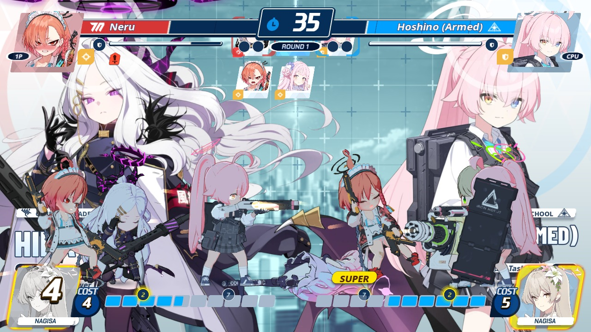
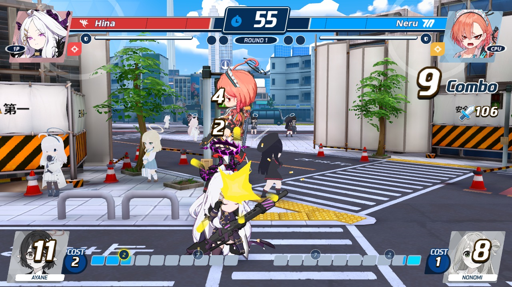
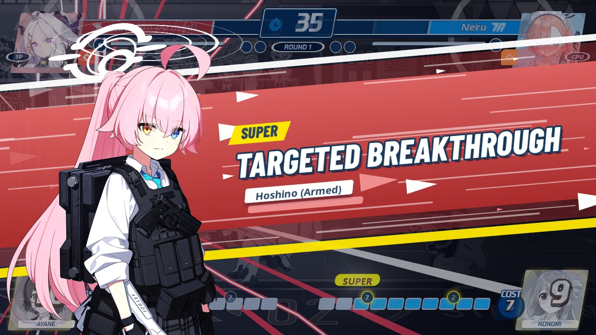
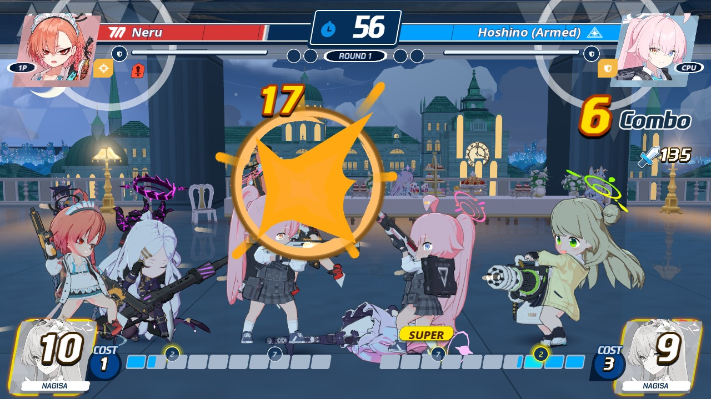

<table>
<tr>
<td></td>
<td></td>
</tr>
<tr>
<td></td>
<td></td>
</tr>
</table>

Blue Archive Fighting Game is a fan-made 2D fighting game set in Blue Archive. You pick a student and a support, pick a stage and fight a best of three. It's inspired by Melty Blood: Type Lumina, Under Night In-Birth II Sys:Celes, Dragon Ball FighterZ and BlazBlue: Central Fiction.

Direct Inspiration goes to [@ThatKirbo](https://x.com/ThatKirbo) On Twitter. They inspired me to start this project.

## Download

Get the zip for your system from [Releases](https://github.com/mattsumi/blue-archive-fighting-game/releases), unzip it and run `BlueArchiveFightingGame.exe` on Windows, the app on macOS, or `BlueArchiveFightingGame.x86_64` on Linux. There's no installer.

The builds aren't signed, so macOS and Windows will complain the first time you open it. On macOS right-click the app and choose Open. On Windows click More info and then Run anyway.

## Recommended specs

These are targets, not tested limits. I've only been able to test on my own Mac so far, where it holds 60 fps on every stage, so if it runs badly (or fine) on your PC let me know on the [Discord](https://discord.gg/Wf2jtBuNnb).

| | Minimum | Recommended |
| --- | --- | --- |
| OS | Windows 10 64-bit, macOS 11, 64-bit Linux | Windows 10 64-bit, macOS 11, 64-bit Linux |
| CPU | Intel Core i3-12100 or Ryzen 5 5500 | Intel Core i5-12400 or Ryzen 5 5600 |
| GPU | GTX 1060 or RX 470 | GTX 1660 Super or RX 5600 XT |
| VRAM | 2 GB | 4 GB |
| RAM | 8 GB | 16 GB |
| Storage | 1 GB | 1 GB |

The GPU needs Vulkan or DirectX 12. On a Mac you'll want Apple silicon (M1 or newer). The heaviest stage uses about 1 GB of video memory at 1080p, and the game mostly runs on one CPU core, so a fast core matters more than having lots of them.

**Online needs Steam and a Discord account.**

## What's in it

- 4 students: Hina, Hoshino (Armed), Neru and Mika
- 10 supports you can call in during a fight, each using her EX skill from the game
- 4 stages: Gehenna, D.U. Shiratori City, Millennium Arena and Tea Party Main Terrace. The last three have day, evening and night versions
- Versus, Versus CPU, Single Play (arcade), Training, Extras and Online
- Online has rollback netcode, rooms, lobbies, Quick Match, spectating and replays
- Training has a dummy you can set up, frame data, hitboxes and a command list

Not done yet: combo trials, a tutorial, story mode, ranked and more students and stages.

**Which students and stages come next gets decided with community polls on the [Discord server](https://discord.gg/Wf2jtBuNnb).**

## Controls

These are the defaults, you can change them in Options > Controls.

| | Keyboard 1 | Keyboard 2 | Gamepad |
| --- | --- | --- | --- |
| Move | WASD | Arrow keys | Left stick / D-pad |
| Light | R | ; | X |
| Medium | T | ' | Y |
| Heavy | G | Backspace | B |
| Gun | F | Enter | A |
| Assist | Q | , | LB |
| Dash | E | . | RB |
| Pause | V | Numpad 5 | Start |

Specials are motion inputs like 236 and 214. The Command List in the pause menu has every student's moves.

## Saves

Saves and settings live here:

- Windows: `%APPDATA%\Godot\app_userdata\Blue Archive Fighting Game`
- macOS: `~/Library/Application Support/Godot/app_userdata/Blue Archive Fighting Game`
- Linux: `~/.local/share/Godot/app_userdata/Blue Archive Fighting Game`

If Steam is open it'll show the game as Spacewar. That's Valve's test app ID, which the game uses for now.

## Credits

Made by [mattsumi](https://github.com/mattsumi). Everyone else who helped, and where the models, art and music come from, is in [CREDITS.md](CREDITS.md).

This is an unofficial fan project and isn't affiliated with NEXON Games or Yostar. Blue Archive and everything from it belongs to them.

---

Made with love by konekurosawa

Leave a buck if you want. It incentivizes me to work on this. 

